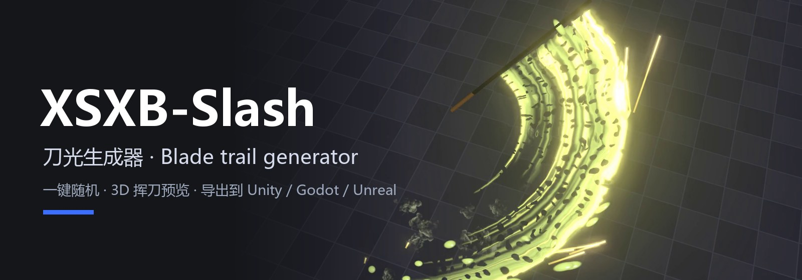
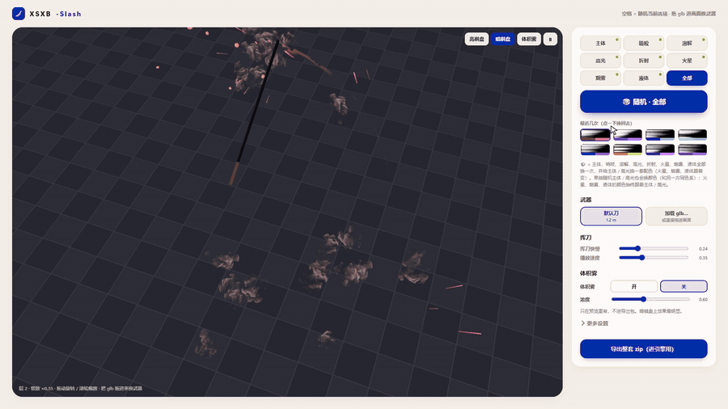
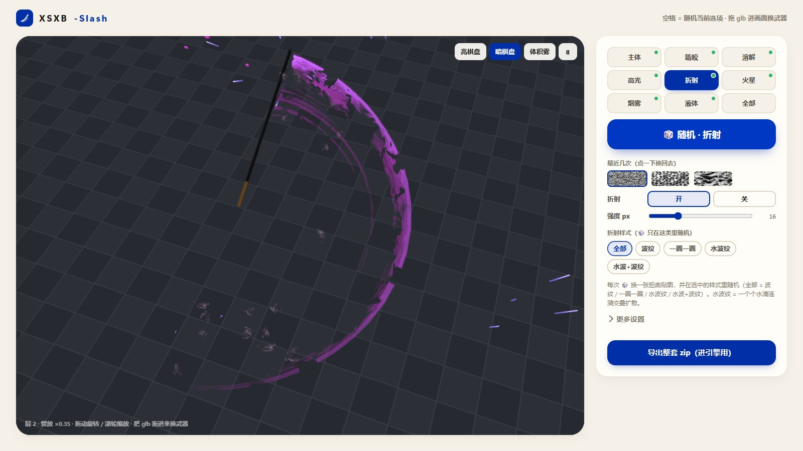
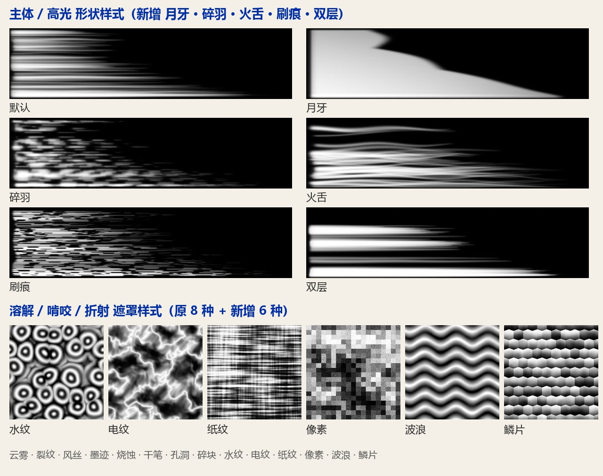
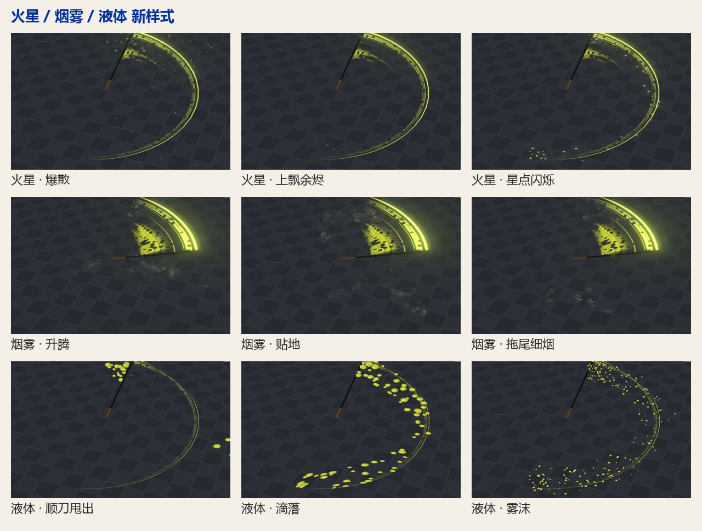
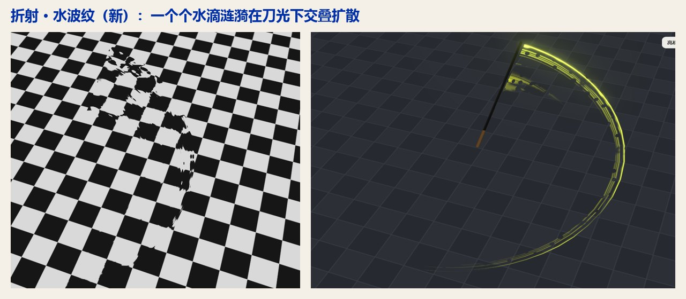

<p align="center"></p>

# XSXB-Slash 刀光生成器

**中文** | [English](README_en.md)

在浏览器里做游戏刀光：一键随机贴图、叠层、3D 预览挥刀，再导出一个包，放进 Unity、Godot 或 Unreal。

<p align="center"></p>

*上面是演示视频里的一小段（连按 🎲 随机）。完整视频：[xsxb-slash-demo.mp4](docs/media/xsxb-slash-demo.mp4)*

## 截图



**样式**：每一项都有好几种生成算法，🎲 会在里面随机；也可以在「详细」里锁定一种。
- 主体 / 高光：默认、细密丝、粗团块、短尾、均匀条、云团，新增 **月牙、碎羽、火舌、刷痕、双层**（高光另有双线、断续、月牙光等）。
- 溶解 / 啃咬 / 折射贴图：云雾、裂纹、风丝、墨迹、烧蚀、干笔、孔洞、碎块，新增 **水纹、电纹、纸纹、像素、波浪、鳞片**。
- 折射：波纹、一圈一圈，新增 **水波纹**（水滴涟漪交叠扩散）和 **水波+波纹**。
- 火星：新增 爆散、上飘余烬、星点闪烁；烟雾：新增 升腾、贴地、拖尾细烟；液体：新增 顺刀甩出、滴落、雾沫。





## 怎么用

1. 下载本仓库，用浏览器打开 `index.html`。不用安装；3D 预览从 CDN 加载 three.js，需要联网。
2. 右侧选一项（主体 / 啃咬 / 溶解 / 高光 / 折射 / 火星 / 烟雾 / 液体 / 全部），点 **🎲 随机** 或按 **空格**。不满意就再按；「最近几次」里点一下能换回去。
3. 想换武器：点 **加载 glb…**，或者直接把 `.glb` 拖进画面。刀光从刀身起点画到刀尖。
4. 细调：**更多设置** 里有场景、各层参数、贴图预设、通道打包等。
5. 满意了点 **导出整套 zip（进引擎用）**。

导出包里有：

```
recipe.json            所有层和参数（线性颜色，单位：米、秒）
textures/shape.png     主体形状   Clamp，关 sRGB
textures/mask.png      遮罩/溶解  Repeat，关 sRGB
textures/highlight.png 高光       Clamp，关 sRGB
preview.png            预览参考图
```

[examples/fable](examples/fable) 是一个导出好的例子。

## 放进游戏引擎

- **手动：** 按 [skill/xsxb-slash-install/SKILL.md](skill/xsxb-slash-install/SKILL.md) 的步骤做（Unity、Godot 4、Unreal 5 都有）。
- **让 AI 编程助手装：** 把 `skill/xsxb-slash-install` 交给它（Claude Code：复制到项目的 `.claude/skills/`），再给它导出包，说「把这个刀光装到我的剑上」。装好以后再导出新的刀光，说「换成这个刀光」，它只替换 recipe 和三张贴图，不改代码。

| 目录 | 内容 |
|---|---|
| `docs/SPEC.md` | 规格：条带 UV、着色器公式、单位、自检方法 |
| `engines/unity/` | `XsxbSlashTrail.cs` + `XsxbSlashTrail.shader`（Built-in / URP） |
| `engines/godot/` | `xsxb_slash_trail.gd` + 着色器（Godot 4） |
| `engines/unreal/` | `XsxbSlashTrailComponent`（C++，ProceduralMesh）+ `XsxbSlashLayer.hlsl`（材质 Custom 节点） |
| `skill/xsxb-slash-install/` | AI 助手用的安装说明 |

## 说明

- 刀光贴图都由工具自己生成，不取自任何游戏。`assets/smoke_sheet_2048.png`（烟雾序列帧，作者自制）可随意使用；`assets/smoke_sheet.js` 是同一张图，内嵌后可以直接用 `file://` 打开页面。
- 折射、火星、液体、烟雾、细节抖动、颜色随年龄变化，在网页里是预览效果。recipe 会记下它们的参数（见 `docs/SPEC.md` 4b），引擎端的参考代码只画刀光条带。

## 许可

[MIT](LICENSE)
