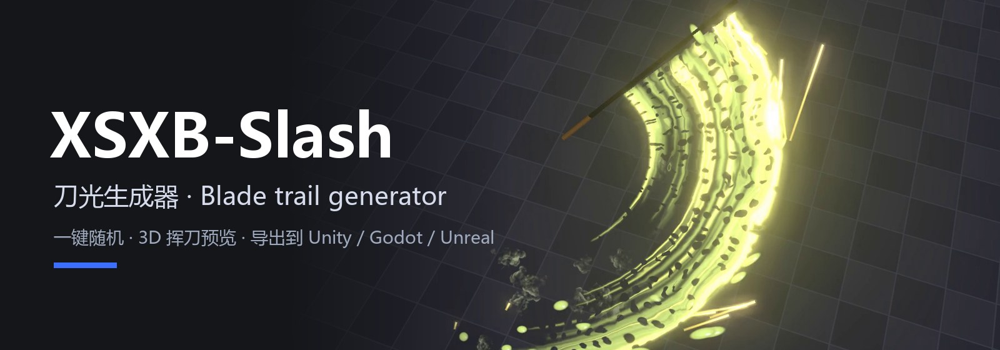
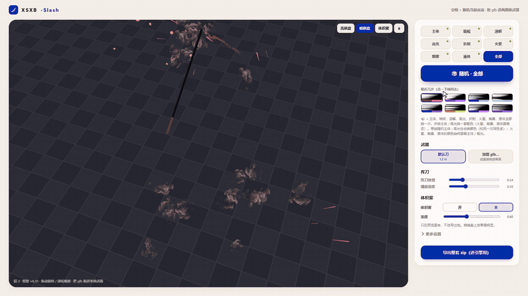
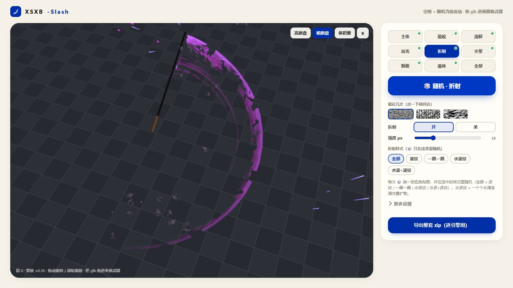
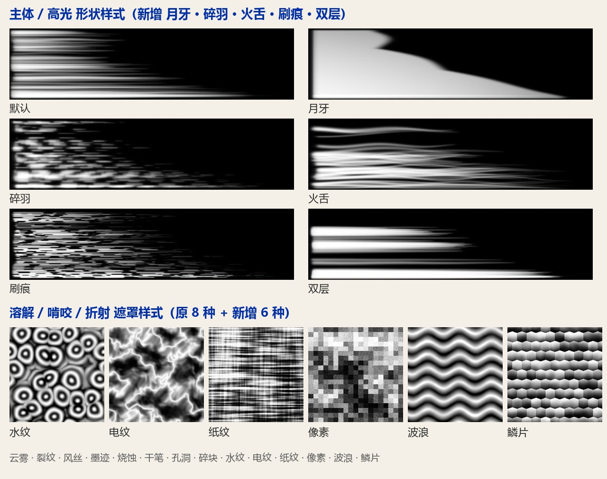
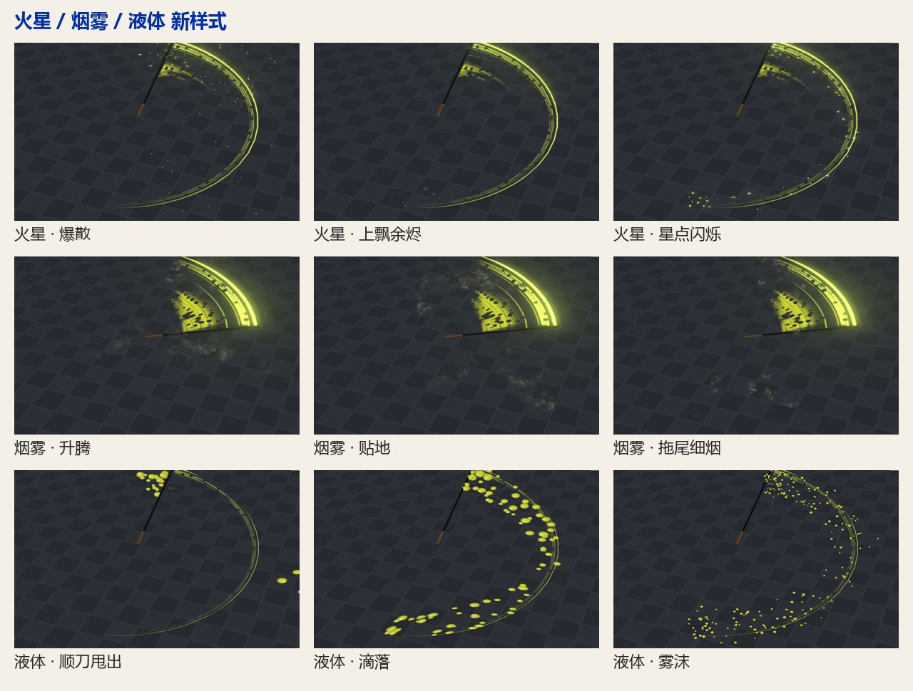
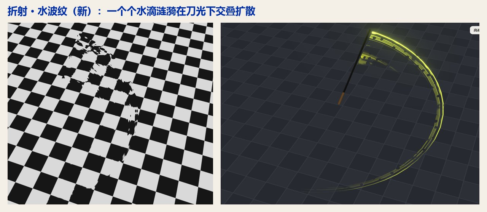

<p align="center"></p>

# XSXB-Slash

[中文](README.md) | **English**

A browser tool for game sword slash trails: roll random textures, stack layers, preview the swing in 3D, and export a bundle for Unity, Godot or Unreal.

<p align="center"></p>

*A short cut from the demo video (pressing 🎲 again and again). Full video: [xsxb-slash-demo.mp4](docs/media/xsxb-slash-demo.mp4). The UI is in Chinese.*

## Screenshots



**Styles**: every item has several generators; 🎲 picks among them, or lock one under 详细 (details).
- Body / highlight shapes: default, fine strands, thick clumps, short tail, even bars, cloud, plus new **crescent, feather, flame, brush, double band** (highlight also gets double line, broken, crescent glow…).
- Dissolve / gnaw / refraction masks: cloud, crack, wind streak, ink, burn, dry brush, holes, shards, plus new **ripple, bolt, paper fibre, pixel, wave, scales**.
- Refraction: wave, rings, plus new **water ripples** (overlapping droplet rings) and **water + wave**.
- Sparks: new burst, rising embers, twinkle; smoke: new rise, ground, wisp; liquid: new spray, drip, mist.





## How to use

1. Download this repo and open `index.html` in a browser. Nothing to install; the 3D preview loads three.js from a CDN, so it needs internet.
2. On the right, pick an item (主体 body / 啃咬 gnaw / 溶解 dissolve / 高光 highlight / 折射 refraction / 火星 sparks / 烟雾 smoke / 液体 liquid / 全部 all), then press **🎲 随机** (random) or **Space**. Press again until you like it; click a thumbnail under 最近几次 (recent) to go back.
3. Other weapon: **加载 glb…** (load glb) or drag a `.glb` onto the preview. The trail runs from the blade start to the tip.
4. Fine tuning: **更多设置** (more settings) has the scene, per-layer parameters, texture presets and channel packing.
5. Press **导出整套 zip（进引擎用）** (export bundle).

The bundle:

```
recipe.json            all layers and parameters (linear colours, metres, seconds)
textures/shape.png     main shape     Clamp, sRGB off
textures/mask.png      mask/dissolve  Repeat, sRGB off
textures/highlight.png highlight      Clamp, sRGB off
preview.png            reference frame
```

[examples/fable](examples/fable) is an exported example.

## Into a game engine

- **By hand:** follow [skill/xsxb-slash-install/SKILL.md](skill/xsxb-slash-install/SKILL.md) (Unity, Godot 4, Unreal 5).
- **With a coding agent:** give it `skill/xsxb-slash-install` (Claude Code: copy it to your project's `.claude/skills/`) and the bundle, and say "install this blade trail on my sword". Later, export a new trail and say "switch to this trail": it replaces only the recipe and the three textures, no code changes.

| Folder | What |
|---|---|
| `docs/SPEC.md` | the contract: strip UVs, shader formula, units, self-check |
| `engines/unity/` | `XsxbSlashTrail.cs` + `XsxbSlashTrail.shader` (Built-in / URP) |
| `engines/godot/` | `xsxb_slash_trail.gd` + shaders (Godot 4) |
| `engines/unreal/` | `XsxbSlashTrailComponent` (C++, ProceduralMesh) + `XsxbSlashLayer.hlsl` (material Custom node) |
| `skill/xsxb-slash-install/` | agent skill |

## Notes

- All trail textures are generated by the tool; nothing is taken from any game. `assets/smoke_sheet_2048.png` (smoke flipbook, made by the author) is free to use; `assets/smoke_sheet.js` is the same image embedded so the page also works from `file://`.
- Refraction, sparks, liquid, smoke, detail wobble and colour over age are preview features in the page. The recipe records their numbers (`docs/SPEC.md` 4b); the engine reference code draws the trail layers.

## License

[MIT](LICENSE)
